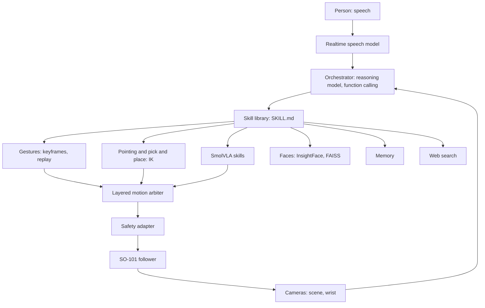

# Architecture

## The target system

A conversational robot with the SO-101 as its body: it listens through the laptop
microphone, answers by voice, gestures, points, and carries out a few tabletop skills.

| Layer | Choice |
|---|---|
| Voice | A realtime speech model over WebRTC, chosen after live tests |
| Orchestrator and planner | A reasoning model with function calling: Gemini Robotics ER 2, with Gemini 4 Argon as the candidate for planning and zero-shot pick and place |
| Manipulation | SmolVLA fine-tuned from `lerobot/smolvla_base`, about three tabletop skills to begin with |
| Gestures | Keyframes and replay |
| Mouth | The gripper follows the amplitude envelope of speech |
| Pointing | VLM pointing, a homography, IK |
| Perception | InsightFace with FAISS |
| Memory | mem0 |
| Concurrency | A layered motion arbiter |
| Safety | A safety adapter between every skill and the motors |

## Safety adapter

It goes in at step 4 of the ladder, the first time something other than a person calls a
motion. Not earlier, when there is nothing to protect, and not later.

- validates the tool name and the parameter schema,
- enforces joint, speed and workspace limits and a minimum height,
- a timeout and a software e-stop,
- an action ledger, so a network retry never doubles a physical motion,
- slow motion while the robot is speaking,
- refuses hallucinated coordinates whatever the model says.

## The learning ladder

Each step teaches one new thing and has to work before the next begins.

| # | What gets built | What it teaches | Roughly |
|---|---|---|---|
| 0 | Move one motor from Python, read position and temperature | Bus, torque, registers, the arm falls without torque | 1 day |
| 1 | A keyframe wave with ease-in and ease-out | Interpolation, limits, the dry-run habit | 2 days |
| 2 | The gripper follows the amplitude of a WAV file | A realtime loop, audio to motor | 2 days |
| 3 | A realtime speech model, conversation only, no robot | Barge-in, voice activity detection, function calling | 3 days |
| 4 | "Wave to me", a tool call, the arm waves, "there, hi" | The vertical slice and the safety adapter | 3 days |
| 5 | Idle breathing, the speaking gripper and a queued gesture together | The layered motion arbiter | 1 week |
| 6 | Face detection, a PID loop, the arm turns toward the person | A closed loop from perception to control | 1 week |
| 7 | VLM pointing, homography, IK, point at an object | 2D to 3D, a VLM in the loop | 1 to 2 weeks |
| 8 | Face recognition and memory, a greeting by name | Identity, memory, privacy in practice | 1 to 2 weeks |
| 9 | 50 episodes, SmolVLA, one tabletop skill as a tool | The whole learning chain on hardware | 3 to 4 weeks |
| 10 | More skills, merged datasets | Scaling the skill library | ongoing |

- Step 2 comes before 3 on purpose: it is offline and deterministic, so the filter is tuned
  once and later only its source changes.
- Step 5 is the first real turning point, where three things pull on the same motors.
- The reasoning model harness from [Gemini ER and Argon](guides/gemini-argon.md) fits beside
  step 7: the same IK, homography and safety layer.

## The library

`src/so101/` holds what survives the labs:

| Package | Holds |
|---|---|
| `simple` | The student API: move a joint, read an angle, check limits, on a simulated or a real arm |
| `motors` | Bus, torque, temperature, current |
| `motion` | Keyframe engine, easing, idle breathing, the arbiter |
| `kinematics` | FK, IK, the table homography |
| `perception` | Cameras, faces |
| `policies` | A wrapper around rollout |
| `safety` | Limits, timeout, e-stop, action ledger |
| `voice` | Microphone, speech models, the realtime loop |
| `agents` | Reasoning model harness, tool registry |

A lab's README states three things: the goal, the command, and "done when". A skill under
`behaviors/` is data, a `SKILL.md` and its keyframes or policy reference, so skills are
added without touching code.
